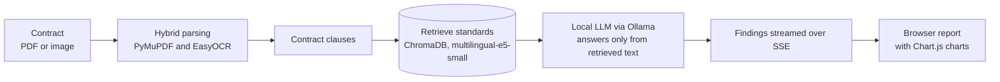

<div align="center">


<br>


</div>

<br>

**Almufti Althaki** (Arabic: المفتي الذكي) is an automated Sharia audit system for financial contracts. It runs **entirely offline**, so sensitive financial data never leaves your machine.

It is built on a retrieval-augmented generation (RAG) architecture that connects Sharia standards to a local language model. Every ruling or audit note is based only on the reference texts you provide.

<div align="center">

</div>

## How it works



1. **Read.** The contract is read with `PyMuPDF` for text PDFs, or with `EasyOCR` for scans and images.
2. **Retrieve.** For each clause, the most relevant Sharia standards are retrieved from a `ChromaDB` vector database.
3. **Answer.** The local model answers using only the retrieved passages (a zero-knowledge constraint), so it cannot rely on outside knowledge.
4. **Stream.** Results stream to the interface clause by clause as they are produced.

## Features

| Area | What it does |
|---|---|
| Air-gapped privacy | Runs fully on your machine through the `Ollama` engine. No data is sent to the cloud |
| Hybrid parsing | Combines `PyMuPDF` for text and `EasyOCR` for scanned contracts and images, chosen automatically |
| Grounded fiqh audit | Searches the Sharia standards in `ChromaDB` and forces the model to answer from the retrieved texts only |
| Live streaming (SSE) | Processes and displays audit results clause by clause in real time |
| Interactive interface | A browser interface for reviewing contracts and reports, with interactive charts built on `Chart.js` |

## Tech stack

| Layer | Technology |
|---|---|
| Backend | FastAPI, Python |
| LLM engine | Ollama (`qwen2.5:1.5b`) |
| Vector database | ChromaDB |
| Embeddings | SentenceTransformers (`multilingual-e5-small`) |
| OCR | EasyOCR |
| PDF parsing | PyMuPDF |
| Frontend | HTML5, CSS3, Vanilla JS, Chart.js |

## Getting started

**Requirements:** Python 3.10 or newer, and [Ollama](https://ollama.com/) installed.

1. **Set up the environment**

   ```bash
   python -m venv venv
   source venv/bin/activate   # On Windows: .\venv\Scripts\activate
   pip install -r requirements.txt
   ```

2. **Download the local model**

   ```bash
   ollama pull qwen2.5:1.5b
   ```

3. **Build the knowledge base (RAG)**

   ```bash
   python build_knowledge_base.py
   ```

4. **Start the server**

   ```bash
   uvicorn api:app --reload
   ```

5. **Open the interface.** Open the file `المفتي-الذكي.html` in your browser and start auditing contracts.

## Screenshots

<table>
  <tr>
    <td width="50%"></td>
    <td width="50%"></td>
  </tr>
  <tr>
    <td width="50%"></td>
    <td width="50%"></td>
  </tr>
</table>

## Responsible use

Almufti Althaki supports the audit process. It does not replace a qualified Sharia scholar, and its findings should be reviewed by a person before any decision is made. A small local model trades some accuracy for privacy and speed.

## Credits

Built with [Ollama](https://ollama.com/), [ChromaDB](https://www.trychroma.com/), [FastAPI](https://fastapi.tiangolo.com/), [PyMuPDF](https://pymupdf.readthedocs.io/), [EasyOCR](https://github.com/JaidedAI/EasyOCR), [SentenceTransformers](https://www.sbert.net/) and [Chart.js](https://www.chartjs.org/). The banner and logo use the Fraunces, Reem Kufi and Figtree typefaces under the SIL Open Font License (see `assets/`).
