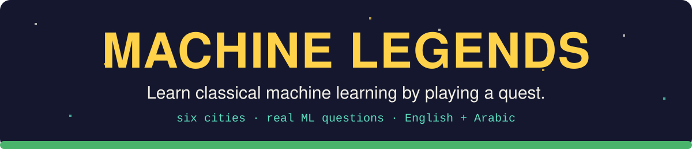
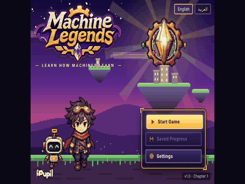
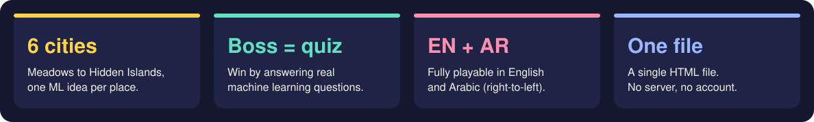
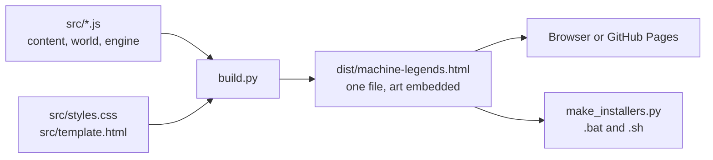

<p align="center">
  
</p>

<p align="center">
  <a href="https://Ahmed-ssam.github.io/Machine-Legends/"></a>
  &nbsp;
  <a href="https://github.com/Ahmed-ssam/Machine-Legends/releases/latest"></a>
  &nbsp;
  <a href="https://ahmed-elmasry99xyz.itch.io/machine-legends"></a>
</p>

<p align="center">
  
</p>

Walk through six cities with Milo, talk to the villagers, solve their problems, and face a boss in each city. Every boss is beaten by answering real machine learning questions, and each city teaches one idea: examples and rules, training and testing, decision trees, nearest neighbors, fitting lines, and probability. Finish the journey and you get a personal completion certificate. Plain JavaScript, no engine, no dependencies. The whole game is one HTML file. Fully playable in **English and Arabic**.

> **Status.** All six chapters are playable end to end, in both languages. The Linux installer was tested; the Windows and macOS installers are untested, so please report problems.

<p align="center">
  
</p>

## Try it

**1. In your browser, no install (best).** Click **Play in browser** above (GitHub Pages) or play on [itch.io](https://ahmed-elmasry99xyz.itch.io/machine-legends). Progress is saved in your browser.

**2. On your computer, one click.** Open the [latest release](https://github.com/Ahmed-ssam/Machine-Legends/releases/latest) and download the installer for your system. It copies the game, adds a desktop icon, and opens in its own app-style window (Edge or Chrome).

- Windows: double-click `Machine-Legends-Setup.bat`. If SmartScreen warns, choose **More info, Run anyway** (the script is plain text; open it to check).
- macOS / Linux: run `bash Machine-Legends-Setup.sh`

**3. From source.**

```bash
git clone https://github.com/Ahmed-ssam/Machine-Legends.git && cd Machine-Legends
python3 build.py                 # writes dist/machine-legends.html
python3 -m http.server -d dist   # or just open the file
```

Needs Python 3.9 or newer for the build. The game itself needs only a modern browser.

## What you learn

| City | Idea | Boss |
|---|---|---|
| Learning Meadows | Examples and rules | Tutorial quiz |
| Model Workshop | Training and testing | Cheater, the Data Leaker |
| Forest of Patterns | Decision trees and voting | Fanatic, the Biased Learner |
| Valley of Neighbors | Nearest neighbors and scaling | Bulk, the Loudest Number |
| Valley of Predictions | Fitting lines, bias and variance | Rote, the Overfitter |
| Islands of Hidden Knowledge | Probability, hidden groups, honest testing | Lag, the Drifting Model |

Side quests, a Codex of terms you have met, and a certificate at the end.

## Controls

| Action | Keyboard | Touch |
|---|---|---|
| Move | Arrow keys or WASD | On-screen pad (appears on touch devices) |
| Talk, confirm | Enter, Space or E | Action button |
| Pause menu, back | Esc | Menu button |
| Journal | J | Menu |
| World map | M | Menu |

## How it works



1. `build.py` joins the source files in a fixed order into a single script, inlines the CSS and the sprite atlas, and writes one HTML file.
2. Everything is drawn on a canvas with a small tile engine; sounds are generated live with Web Audio, so there are no audio files.
3. Text lives in one table with English and Arabic strings per key. The Arabic mode switches direction and font.
4. Character art is packed into `src/npc_art.js` by `tools/make_npc.py` from source sheets.

## Project layout

| Path | What is in it |
|---|---|
| `src/` | game source: core, content, text, sprites, world per city, engine, certificate |
| `build.py` | bundles `src/` into `dist/machine-legends.html` |
| `tools/` | art packing, icon, desktop installer builder |
| `tests/` | Playwright playthrough scripts (English and Arabic) |
| `installers/` | ready-made desktop installers |
| `docs/` | GitHub Pages copy of the game (`index.html`), README images |

## Limitations

- The 18 secondary characters from the second art sheet are low resolution and look soft when scaled up.
- Playthrough tests drive the real UI and are slow; the Arabic runs are flaky because of button-text matching.
- The Windows and macOS installers have not been tested on real machines.
- Desktop mode needs Edge or Chrome; other browsers open the game in a normal tab.

## Development

```bash
python3 build.py
pip install playwright && playwright install chromium
python3 tests/play.py          # drives the built game with Playwright
python3 docs/img/make_assets.py   # regenerate banner, buttons and demo.gif
python3 tools/make_installers.py  # rebuild the desktop installers
```

See [CONTRIBUTING.md](CONTRIBUTING.md) and [CHANGELOG.md](CHANGELOG.md).

## Credits and licenses

Machine Legends is MIT licensed, see [LICENSE](LICENSE). Code and design by Ahmed-ssam. Character art is supplied by the author and packed from the author's sheets. Fonts are loaded from Google Fonts when online: Baloo 2, Cairo and DotGothic16 (SIL Open Font License), with system fallbacks offline.
