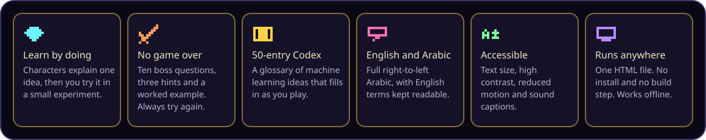
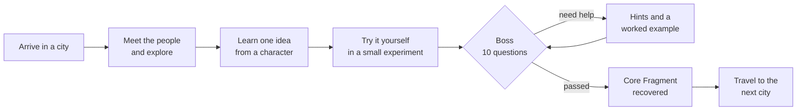
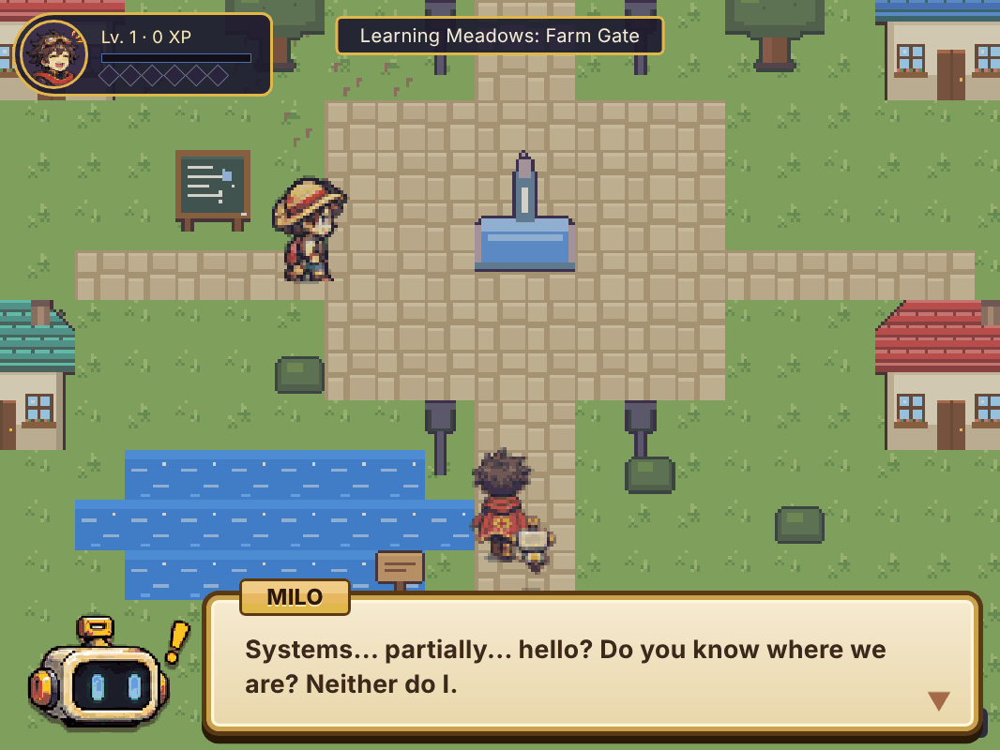
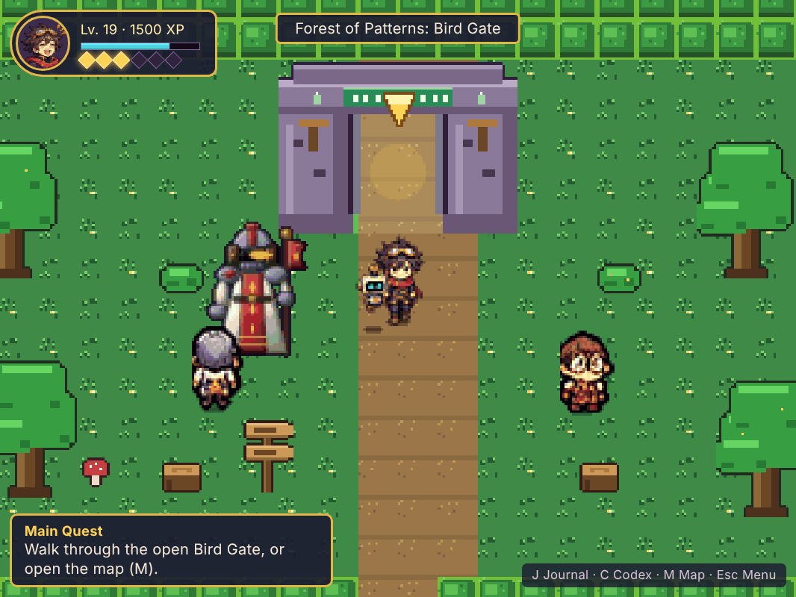
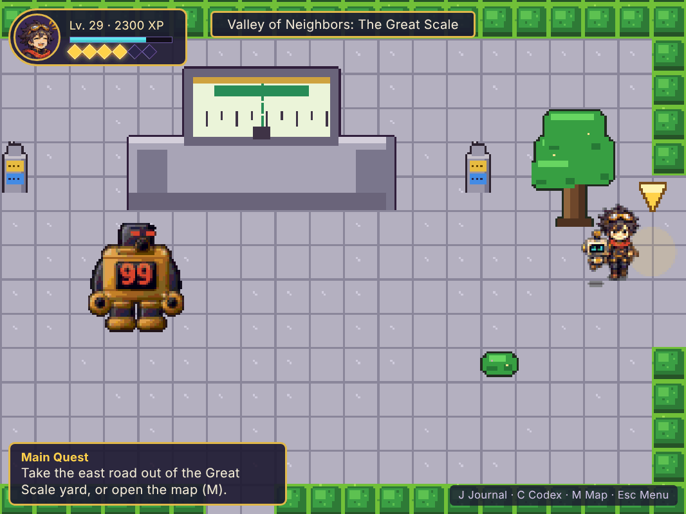
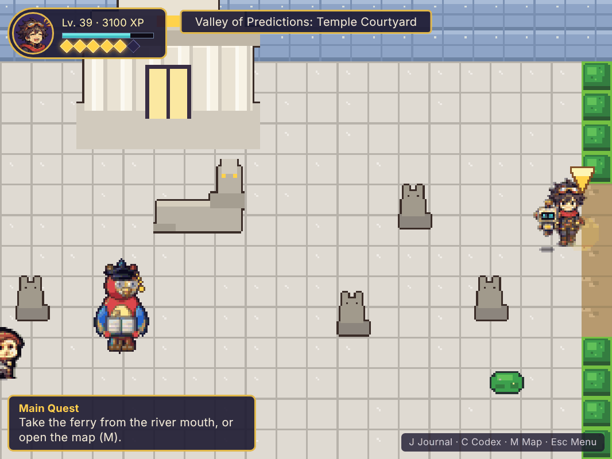
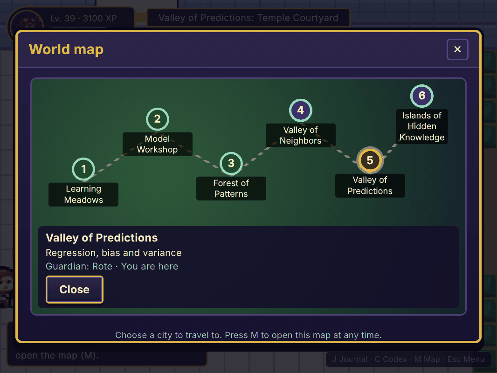
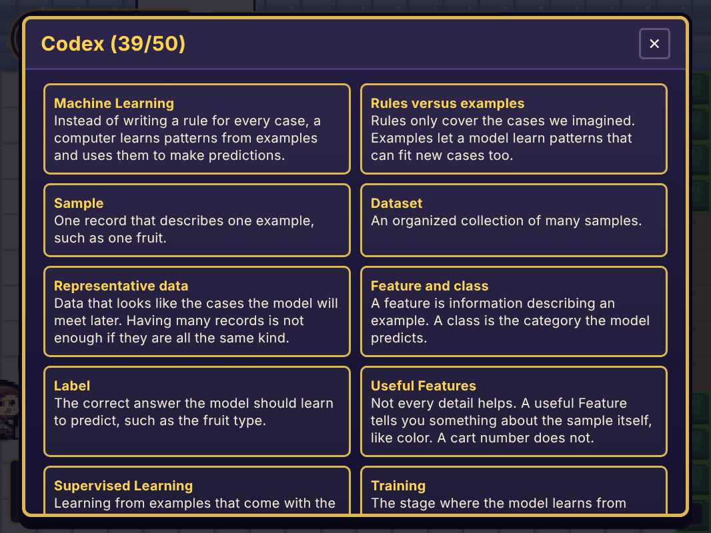
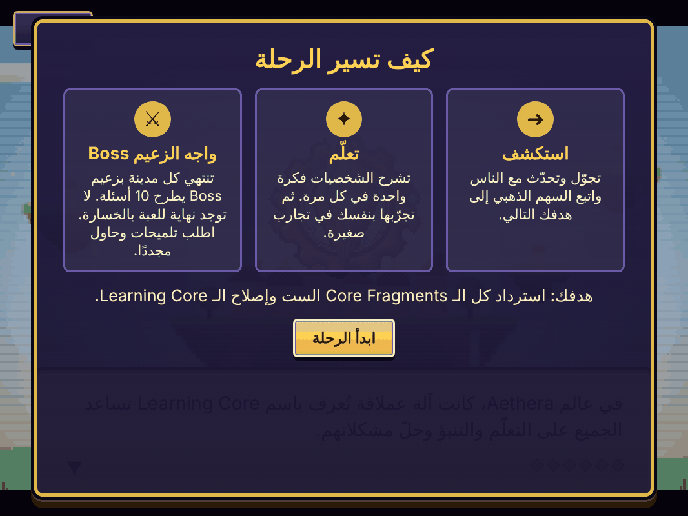

 

 

**Machine Legends** is an educational pixel-art RPG from the iPupil studio. It teaches the core ideas of machine learning through exploration, small experiments and boss questions. It runs in any modern browser from a single HTML file, in English and Arabic.

## The story

In the world of Aethera, a giant machine called the **Learning Core** once helped everyone learn, predict and solve problems. Then it cracked. Six **Core Fragments** fell across the land, and the lessons they carried turned into six broken rules. Machines began to guess instead of learn, gates turned good fruit away, and records filled with mistakes.

You play a traveler who wakes up beside **MILO**, a small robot that has lost most of its memories. Together you visit six cities. In each one you meet people, learn one big idea by trying it yourself, and face the Boss who broke that rule. Recover all six Core Fragments to restore the Learning Core.

## How a city plays

## What you learn

Each city teaches one cluster of machine learning ideas, from first principles to honest evaluation.

| # | City | Boss | Ideas you practice |
|---|---|---|---|
| 1 | Learning Meadows | Misprint | Learning from examples, samples and datasets, features and labels, supervised learning, label quality |
| 2 | Model Workshop | Cheater | Training versus test data, splitting data, data leakage, why a perfect score can be dishonest |
| 3 | Forest of Patterns | Fanatic | Classification, decision trees, voting, and asking who is missing from the data |
| 4 | Valley of Neighbors | Bulk | Distance, feature scaling, nearest neighbors, keeping test data out of preparation |
| 5 | Valley of Predictions | Rote | Regression, fitting a line, measuring errors, balancing too simple against too wiggly |
| 6 | Islands of Hidden Knowledge | Lag | Probabilities, finding hidden groups, supervised versus unsupervised learning, testing a model honestly |

Everything you discover is saved to the **Codex**, a glossary of 50 entries that fills in as you play.

## Features

| Area | Details |
|---|---|
| Learning by doing | Characters explain one idea at a time, then you try it yourself in small interactive experiments |
| Boss encounters | Every city ends with a Boss who asks 10 questions. There is no game over: ask for up to three hints, see a worked example, and try again |
| Practice rounds | Optional rehearsals before each boss and three side quests per city |
| Progress tools | Journal for main and side quests, Codex, and a world map for traveling between cities |
| Certificate | Finish the game, enter your name and save a completion certificate as an image |
| Bilingual | Full English and Arabic text, with right-to-left layout and English technical terms kept readable inside Arabic sentences |
| Accessibility | Adjustable text size and speed, high contrast, reduced motion, sound captions, and separate volume and mute controls |
| Saves | Progress saves automatically in your browser, with a manual save option |

## Screenshots

<table>
  <tr>
    <td> Meeting MILO in Learning Meadows</td>
    <td> The Bird Gate in the Forest of Patterns</td>
  </tr>
  <tr>
    <td> Bulk at the Great Scale in the Valley of Neighbors</td>
    <td> Rote in the Temple Courtyard</td>
  </tr>
  <tr>
    <td> World map with six cities</td>
    <td> The Codex of machine learning concepts</td>
  </tr>
</table>

 
The full Arabic interface, with right-to-left layout

## Controls

| Action | Keys |
|---|---|
| Move | Arrow keys or WASD |
| Talk or interact | Space, Enter or E |
| Journal | J |
| Codex | C |
| World map | M |
| Pause and settings | Esc |

On touch devices the game shows an on-screen D-pad and an action button.

## Play and install

| Option | How |
|---|---|
| Play in the browser | Open the [itch.io page](https://ahmed-elmasry99xyz.itch.io/machine-legends). Nothing to install |
| Install on Windows | Download [`Machine-Legends-Setup.bat`](https://github.com/Ahmed-ssam/Machine_Legends/releases/latest/download/Machine-Legends-Setup.bat) and double-click it. It installs the game and adds a desktop shortcut and a Start menu entry |
| Install on macOS or Linux | Download [`Machine-Legends-Setup.sh`](https://github.com/Ahmed-ssam/Machine_Legends/releases/latest/download/Machine-Legends-Setup.sh), then run `bash Machine-Legends-Setup.sh`. It adds a desktop shortcut and an application menu entry |
| Run the built game | Open the game's single HTML file in a modern browser. No server is needed |

The installers are self-contained and work offline. They open the game in its own app-style window using Chrome, Edge or Brave when one is installed, and in the default browser otherwise.

To serve the game over HTTP instead, run `python -m http.server` in the folder that contains the HTML file and open `http://localhost:8000`.

The game works offline. The only network request is for the web fonts, which load in the background, and the game falls back to system fonts if they are unavailable.

## Technical notes

- **Self-contained build.** The shipped game is one HTML file with all code, styles, text and artwork inline.
- **Vanilla JavaScript.** No framework and no bundler. The game world is drawn on an HTML Canvas, and the interface is plain DOM.
- **Generated pixel art.** Characters, portraits, tiles and icons are drawn in code, and the title logo is embedded in the file.
- **Generated audio.** Music and sound effects are synthesized with the Web Audio API, so there are no audio files.
- **Internationalization.** All text is stored as English and Arabic pairs and switches instantly, with bidirectional text handling for mixed Arabic and English sentences.
- **Local saves.** Progress and settings are stored in the browser's `localStorage` and never leave the device.

## Credits

Created by **iPupil**, an educational game studio founded by Ahmed Elmasry ([@Ahmed-ssam](https://github.com/Ahmed-ssam)).

Web fonts: DotGothic16, Baloo 2 and Cairo from Google Fonts, under the SIL Open Font License. The banner and buttons embed DotGothic16 and Figtree, also under the SIL Open Font License.
